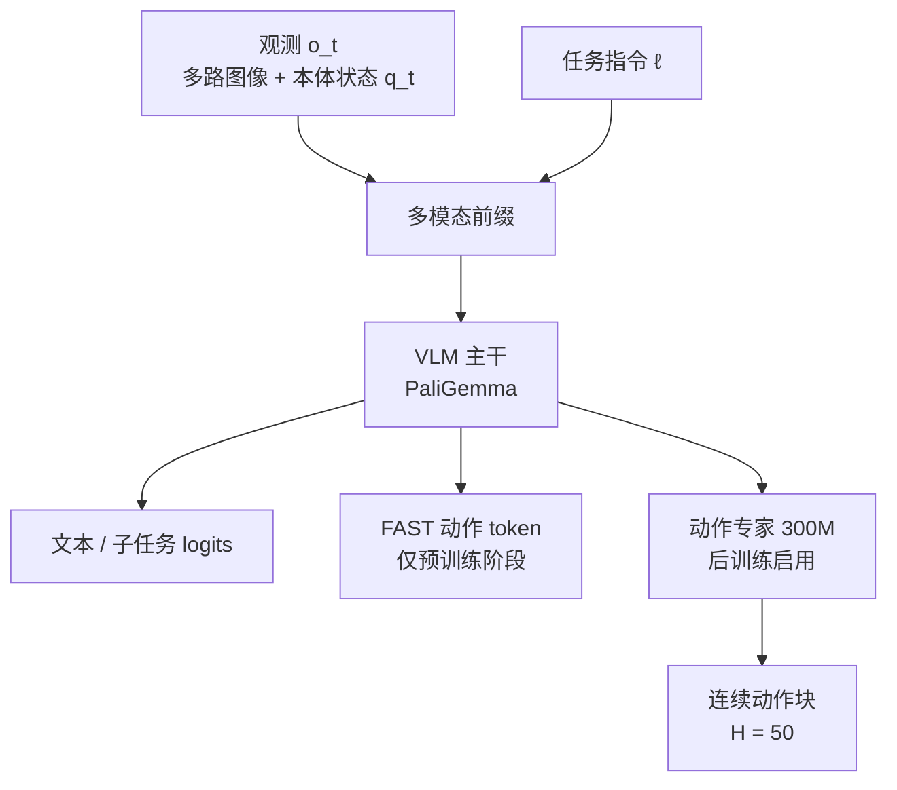
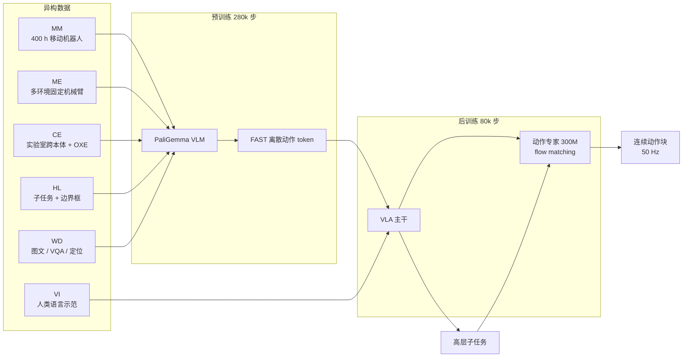
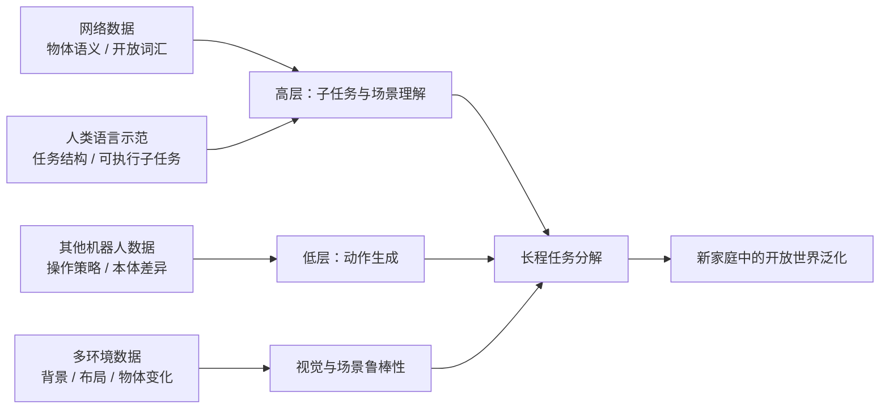

# π0.5：用异构数据协同训练实现开放世界泛化的 VLA

**一句话总结**：π0.5 把移动机器人数据、其他机器人/其他环境的数据、实验室跨本体数据、高层子任务标注、网络多模态数据和人类语言示范放进同一个序列建模框架中协同训练；再用“离散 token 预训练 + 流匹配动作专家后训练”的两阶段方案，让一个统一模型先在高层预测“下一步做什么”，再在低层以 50 Hz 输出连续动作块，从而在从未见过的真实家庭中完成 10–15 分钟级的厨房/卧室整理任务。

---

## 1. 论文想解决什么问题？

VLA 已经能完成不少灵巧操作，但绝大多数评测仍发生在与训练数据高度相似的场景里。论文把难点概括为三层：

1. **场景开放**：新家庭的布局、背景、物体类别和摆放方式都与训练集不同。
2. **任务长程**：清理厨房不是单个抓取，而是“打开抽屉 → 拿起餐具 → 放进水槽 → 关上抽屉”等多阶段行为，可能持续数分钟。
3. **数据不可能穷举**：靠暴力扩大目标机器人数据来覆盖所有家庭和物体，成本不可接受。

作者的核心判断是：机器人也需要像人一样，从**第一手经验、别人的经验、其他任务的经验、语言教导和常识**中迁移知识。对应到模型，就是设计一个能吸收**异构数据源**的协同训练配方，而不是只堆目标域机器人数据。

---

## 2. 核心贡献

- **一套面向开放世界泛化的 VLA 协同训练配方**：把机器人数据与非机器人数据统一成序列建模任务。
- **混合动作表示**：预训练用 FAST 离散动作 token，后训练加入 flow matching 动作专家，兼顾训练效率与实时连续控制。
- **统一的高层/低层模型**：同一个模型既预测语义子任务，又预测低层动作，形成类似“具身链式思考”的分层推理，但高层推理频率低于低层控制。
- **真实家庭中的端到端验证**：据作者所知，这是首个在完全未见的真实家庭中完成长程、灵巧整理任务的端到端学习系统。

一个很有说服力的数字：**预训练第一阶段 97.6% 的训练样本并不来自目标移动机器人**，而是来自其他机器人、网络数据和高层标注。目标机器人数据只有约 **400 小时、约 100 个家庭环境**。

---

## 3. 模型架构

### 3.1 输入、输出与概率分解

模型接收：

- 多路图像 \(I_t^1,\dots,I_t^n\)；
- 机器人本体状态 \(q_t\)（关节角、夹爪位姿、躯干升降、底盘速度等）；
- 语言任务指令 \(\ell\)（如“clean the kitchen”）。

记观测为 \(o_t=[I_t^1,\dots,I_t^n,q_t]\)。模型同时输出文本 \(\hat\ell\) 和动作块 \(a_{t:t+H}\)，并把联合分布分解为：

\[
\pi_\theta(a_{t:t+H},\hat\ell\mid o_t,\ell)
=
\pi_\theta(a_{t:t+H}\mid o_t,\hat\ell)\,
\pi_\theta(\hat\ell\mid o_t,\ell)
\]

其中：

- \(\pi_\theta(\hat\ell\mid o_t,\ell)\) 是**高层策略**：根据当前画面和总任务，预测下一步子任务，例如“pick up the plate”；
- \(\pi_\theta(a_{t:t+H}\mid o_t,\hat\ell)\) 是**低层策略**：以该子任务为条件，输出动作块。

论文强调：动作分布不直接依赖总任务 \(\ell\)，只依赖高层预测出的 \(\hat\ell\)。这让同一个模型可以灵活地在“说话”和“行动”之间切换。

### 3.2 双专家 Transformer

π0.5 的主干是 **PaliGemma VLM**（SigLIP 400M 视觉编码器 + Gemma 2B 语言主干；论文图中标注约 2.6B 参数），并额外配一个约 **300M** 参数的**动作专家（action expert）**。

关键设计是**注意力掩码**：

- 图像、文本提示、本体状态组成前缀，使用全注意力；
- FAST 动作 token 可以注意前缀，并在动作 token 之间因果注意；
- 动作专家可以注意前缀和彼此，但**不能注意 FAST 动作 token**；
- VLM 的嵌入也**不能注意动作专家**。

因此信息是**单向**的：VLM → 动作专家。这样既能让动作专家专注流匹配去噪，又避免两种动作表示之间发生信息泄漏。

### 3.3 为什么同时用离散动作和连续动作？

这是论文工程上很关键的一点。

| 表示 | 优点 | 缺点 | 用在哪里 |
|---|---|---|---|
| FAST 离散动作 token | 训练稳定、可扩展、适合下一 token 预测 | 推理时需要自回归解码，实时性较差 | 预训练 |
| Flow matching 连续动作 | 表达细腻、推理快、适合实时控制 | 直接从头训练不如离散 token 稳定 | 后训练 |

后训练时，模型同时优化两个目标：

\[
\mathcal{L}
=
\mathbb{E}_{\mathcal{D},\tau,\omega}
\left[
\mathrm{CE}\left(x_{1:M}, f^\ell_\theta(o_t,\ell)\right)
+
\alpha
\left\|
(\omega-a_{t:t+H})
-
f^a_\theta\left(a^{\tau,\omega}_{t:t+H},o_t,\ell\right)
\right\|_2^2
\right]
\]

其中流匹配插值定义为：

\[
a^{\tau,\omega}_{t:t+H}
=
\tau a_{t:t+H}+(1-\tau)\omega,
\qquad
\omega\sim\mathcal{N}(0,I)
\]

- \(\mathrm{CE}\) 项保留文本与子任务预测能力；
- 第二项训练动作专家预测向量场；
- 预训练时取 \(\alpha=0\)，等价于纯离散 token 的 VLM 训练；
- 后训练时取 \(\alpha=10.0\)，动作专家随机初始化后加入。

推理时，先自回归解码出文本/子任务，再做 **10 步去噪**得到连续动作块。动作块长度约为 50 步（论文记 \(H=49\)），控制频率为 **50 Hz**。

---

## 4. 数据配方：论文真正的“主角”

π0.5 的数据不是一个大杂烩，而是按“知识类型”分工的六类数据。

| 数据源 | 内容 | 规模/特点 | 主要作用 |
|---|---|---|---|
| **MM**：移动机器人 | 移动机械臂在家庭中做家务 | 约 400 小时，约 100 个家庭 | 与评测最直接相关的第一手经验 |
| **ME**：多环境非移动机器人 | 固定在台面/支架上的单臂或双臂机器人，在多种家庭中采集 | 比移动平台更容易搬运，因此环境更多样 | 跨环境视觉与操作经验 |
| **CE**：实验室跨本体数据 | 实验室桌面环境中的多种机器人、多种任务；也包含 OXE 开源数据 | 本体和任务多样，但环境较简单 | 跨本体操作策略迁移 |
| **HL**：高层子任务标注 | 人工标注“adjust the blanket”“pick up pillow”等子任务；还标注当前观测中的相关边界框 | 覆盖 MM/ME/CE 中多阶段任务 | 让模型学会“下一步做什么”，并预测物体位置 |
| **WD**：网络多模态数据 | 图像描述（CapsFusion、COCO）、视觉问答（Cambrian-7M、PixMo、VQAv2）、物体定位；额外加入室内场景与家居物体的边界框数据 | 规模大、语义广 | 物体语义、开放词汇、OOD 语言跟随 |
| **VI**：语言示范 | 专家用户实时“用语言遥操作”机器人，逐步给出合适的子任务命令 | 仅后训练使用；约占高层移动操作样本的 **11%** | 教高层策略生成符合机器人能力与场景的子任务 |

几个容易忽略的细节：

- **所有动作数据都统一预测目标关节位姿和末端位姿**，并通过文本提示中的 `<control mode> joint/end effector <control mode>` 区分控制模式。
- 动作按每个数据集各维度的 **1% 和 99% 分位数**归一化到 \([-1,1]\)，低维机器人动作做零填充，以适配最大动作空间。
- 高层预测时，模型**先预测相关边界框，再预测子任务**；这相当于让模型先“指出物体”，再“决定动作”。
- 后训练会过滤掉失败片段和过长片段，只保留成功且长度合理的 episode。

---

## 5. 两阶段训练与推理

### 5.1 预训练：把所有任务都变成“下一 token 预测”

- **280k 梯度步**；
- 所有任务都用离散 token 表示，包括机器人动作（FAST tokenizer）；
- 训练目标是文本、物体位置和动作 token 的下一 token 预测；
- 数据覆盖 MM、ME、CE、HL、WD。

这一阶段的目标不是直接得到最优控制器，而是让 VLM 从大规模异构数据中获得**语义、视觉、跨本体动作和任务结构**的先验。

### 5.2 后训练：专门化 + 加入连续动作专家

- **额外 80k 步**；
- 动作专家随机初始化；
- 同时保留离散 token 的下一 token 预测，并加入 flow matching；
- \(\alpha=10.0\)；
- 数据为：MM + ME（过滤后的成功短片段）、WD、与 ME 对应的 HL 数据、VI；
- **不再使用 CE 实验室跨本体数据**，让模型聚焦移动操作和多样家庭环境。

### 5.3 推理：先“想一步”，再“动一串”

1. 高层策略根据四路相机和任务指令，预测子任务文本 \(\hat\ell\)；
2. 低层动作专家以 \(\hat\ell\) 为条件，做 10 步流匹配去噪；
3. 输出长度为 50 的动作块，以 50 Hz 执行；
4. 高层推理以**低于低层控制的频率**运行，兼顾长程一致性与实时性。

这很像具身版的 chain-of-thought：先产生一个语义中间量，再用它约束动作。但与一些“每步都调用大模型”的方案不同，π0.5 的高层并不需要和低层同频运行。

---

## 6. 机器人系统

实验使用两种移动机械臂平台，均具备：

- 两条 **6 DoF 机械臂**，配平行夹爪；
- 每只手腕一个单目 RGB 相机，另有前向和后向相机，共 **4 路图像**；
- 全向轮式底盘；
- 躯干升降机构（1D 或 2D）。

状态/动作空间为 **18 或 19 维**。高层推理使用全部四路相机，低层推理使用腕部 + 前向相机。

控制非常“端到端”：

- 模型直接输出机械臂、夹爪、躯干的目标位姿，以及底盘目标速度；
- 以 **50 Hz** 下发，配合 action chunking；
- 底层只用简单 PD 控制器跟踪；
- **没有额外的轨迹规划或碰撞检测**。

这也意味着系统的安全性高度依赖策略本身和数据覆盖，论文没有展开讨论。

---

## 7. 实验设计

### 7.1 评测环境

- **Mock 家庭**：3 个 mock 厨房 + 3 个 mock 卧室，用于可控、可重复的定量比较；
- **真实家庭**：3 个未出现在训练集中的真实家庭，用于最终的真实性验证；
- 物体、背景、布局都与训练集不同。

### 7.2 四项代表性任务与评分

| 任务 | 初始状态 | 评分项 | 满分 |
|---|---|---|---|
| **Dishes in Sink** | 水槽附近有 4 件餐具 | 每拿起 1 件 +1；每放入水槽 1 件 +1 | 8 |
| **Items in Drawer** | 台面上有 1 件物品，下方有抽屉 | 拿起 +1；打开抽屉 +1；放入 +1；关抽屉 +1 | 4 |
| **Laundry in Basket** | 地上有衣物 | 导航并拿起 +1；放入/放到篮子上 +1；完全放入 +1 | 3 |
| **Make the Bed** | 床未整理 | 铺好毯子 +1；放好第一个枕头 +1；放好第二个枕头 +1；毯子非常整齐 +1；两个枕头都非常整齐 +1 | 5 |

每个任务通常做 **10 次试验**，用 rubric 得分百分比表示任务进度。真实家庭中的单个任务约持续 **2–5 分钟**；完整清理厨房或卧室的多阶段行为可达 **10–15 分钟**。

### 7.3 语言跟随实验

在每个场景中放置 5 个物体，只指令机器人移动其中一个。目标物体被故意放得比干扰物更远，因此**不理解语言的策略大约只有 20% 的概率“碰巧”选对**。评测两个指标：

- **Language following rate**：是否选中了指令所指的物体；
- **Success rate**：是否把该物体放到了正确位置。

并区分：

- **in-distribution**：训练中见过的物体类别，但实例是新的；
- **out-of-distribution (OOD)**：训练中完全没见过的物体类别。

---

## 8. 主要结果

### 8.1 真实家庭：能做成，而且不是只会在 mock 里表演

在三个未见的真实家庭中，π0.5 能完成厨房收纳、餐具入水槽、衣物入篮、铺床等任务。图 7 的报告显示，各任务进度大致在 **60%–95%** 区间，且 mock 环境中的表现与真实家庭相当。

几个定性例子：

- Home 1：人类说“put the items in the drawer”，模型自己拆成“拉出抽屉 → 拉出右上抽屉 → 拿起夹子 → 放入抽屉 → 推回抽屉”；
- Home 2：人类说“place the dishes in the sink”，模型依次“拿盘子 → 放水槽 → 拿杯子 → 放水槽 → 拿勺子 → 拿碗”；
- Home 3：人类说“put the laundry in the laundry basket”，模型连续执行“拿衬衫 → 放入篮子 → 再拿衬衫 → 放好”。

这说明模型不是只记住了一条固定轨迹，而是能根据当前场景**在线生成子任务序列**。

### 8.2 环境数量 scaling：多样性比“堆目标数据”更重要

作者固定训练步数，只改变移动操作数据中的环境数量：**3、12、22、53、82、104** 个地点。

结果（据图 8 估算）：

- 3 个地点时，平均任务进度只有约 **15%**；
- 随地点数增加快速上升，104 个地点时约 **80%**；
- 一个直接见过测试家庭的对照模型约 **85%**；
- 只在 104 个地点上直接训练、不使用协同预训练的模型，表现不到 **10%**。

也就是说，**协同预训练让 104 个未见家庭的数据逼近了“见过测试家庭”的效果**。环境多样性带来的泛化收益，远大于只在目标域里增加数据量。

语言跟随也随环境数量稳步提升：分布内物体的跟随率和成功率上升更快，OOD 物体上升较慢但趋势一致。每个新环境都会引入新的家居物品，模型因此逐渐获得对未见类别的语义泛化。

### 8.3 协同训练消融：ME 和 CE 是关键，WD 负责语义/OOD

在 mock 家庭四项任务上的平均任务进度（图 10）：

| 变体 | 平均任务进度 | 相对完整模型 |
|---|---:|---|
| 完整 π0.5 | **约 80%** | — |
| no WD（去掉网络数据） | 约 72% | \(p=0.385\)，不显著 |
| no ME（去掉多环境非移动数据） | 约 54% | \(p<0.001\) |
| no CE（去掉实验室跨本体数据） | 约 52% | \(p<0.001\) |
| no ME or CE（去掉两者） | 约 41% | \(p<0.001\) |

解读：

- **跨本体数据（ME、CE）是主力**：去掉任一项都会大幅下降，两项都去掉接近“崩掉”；
- **网络数据在 mock 家庭平均分上不显著**，但在**OOD 语言跟随**和**高层子任务预测**上很重要；
- 分任务看，`Items in Drawer` 对 WD 很敏感，因为需要广泛的物体语义；`Dishes in Sink` 对 WD 不敏感，但对 ME/CE 很敏感，因为更依赖操作策略；
- `Laundry Basket` 和 `Make Bed` 对高层策略选择相对不敏感，可能因为任务较短或语义推理需求较低。

### 8.4 与 π0 的比较：混合训练更划算

图 12 比较了三个模型（数值据图估算）：

| 任务 | π0.5 | π0-FAST+Flow（无 HL） | π0（300k 步） |
|---|---:|---:|---:|
| Dishes in Sink | **约 90%** | 约 55% | 约 40% |
| Items in Drawer | **约 87%** | 约 69% | 约 7% |
| Laundry Basket | **约 78%** | 约 70% | 约 36% |
| Make Bed | **约 58%** | 约 48% | 约 18% |

结论：

- π0.5 显著优于原始 π0；
- 即使把 π0 训练到 300k 步，仍然明显落后；
- π0-FAST+Flow 已经用上了混合训练配方，但没有 HL/WD 数据，仍不如 π0.5；
- 说明 **FAST 离散 token 预训练在计算效率上优于纯扩散式训练**，而 HL/WD 数据带来了额外增益。

### 8.5 高层推理到底有多重要？

图 13 的平均任务进度（数值据图估算）：

| 高层策略 | 平均任务进度 | 与完整模型比较 |
|---|---:|---|
| 完整 π0.5（高层 + 低层） | **约 80%** | — |
| implicit HL（训练有 HL 数据，但推理不做高层） | 约 74% | \(p=0.144\)，不显著 |
| no HL（训练和推理都没有 HL） | 约 60% | \(p=0.011\) |
| no VI（去掉语言示范） | 约 59% | \(p=0.009\) |
| no WD（去掉网络数据） | 约 59% | \(p=0.008\) |
| GPT-4 作为高层策略 | 约 55% | \(p=0.002\) |
| 人类专家高层 oracle | 约 65% | \(p=0.016\) |

几个重要发现：

1. **完整模型最好，甚至超过人类高层 oracle**。作者认为这说明在机器人数据上微调过的高层策略，比零样本大模型或外部人类指令更匹配低层策略的分布。
2. **implicit HL 是第二好的**，且与完整模型差异不显著。这意味着：即使推理时不显式输出子任务，**训练时加入子任务预测数据**也能显著改善低层策略。高层数据起到了一种“结构化正则”的作用。
3. **no HL 明显变差**，说明高层数据不是可有可无的辅助任务。
4. **no VI 明显变差**，尽管 VI 只占高层移动操作样本的约 11%。这说明少量、高质量的“人类用语言教机器人做子任务”的数据，对高层策略非常关键。
5. **GPT-4 零样本高层策略最差**，说明通用 VLM 的任务分解能力不能直接替代在机器人数据上的适配。

---

## 9. 为什么有效？四个层面的迁移

1. **语义层**：网络图文数据让模型认识大量物体类别、属性和空间关系，支持开放词汇指令和 OOD 物体。
2. **操作层**：其他机器人、其他本体的数据提供抓取、放置、开门、擦拭等可迁移的技能，不必全部从目标机器人数据中学习。
3. **环境层**：多环境数据让视觉编码器和策略对背景、布局、光照、物体实例的变化更鲁棒。
4. **任务层**：高层子任务标注和人类语言示范把长程任务拆成可执行的步骤，使模型能在新场景中“现场规划”，而不是复现固定轨迹。

论文的实验设计基本验证了这四层各自的作用：ME/CE 主要影响操作与环境鲁棒性，WD 主要影响语义与 OOD，HL/VI 主要影响高层任务分解。

---

## 10. 局限与批判性评估

### 10.1 作者自述的局限

- **不熟悉的机械结构**：形状陌生的抽屉把手、物理上很难打开的柜子；
- **部分可观测**：机械臂自身遮挡溢出物，导致模型看不到需要擦拭的区域；
- **高层策略会被干扰**：例如放东西时反复开关同一个抽屉；
- **指令仍然简单**：模型能处理的任务复杂度受训练数据限制，复杂偏好和精细指令尚未覆盖；
- **上下文较短**：缺少跨房间导航、物体位置记忆等长时记忆能力。

### 10.2 评测层面的局限

- 定量评测集中在 **4 个任务**，虽然具有代表性，但不能覆盖“开放世界”的全部含义；
- 真实家庭只有 **3 个**，每个任务约 **10 次试验**，样本量有限；
- 使用 rubric 部分给分，虽然能反映任务进度，但也可能掩盖“看似完成、实则不稳定”的问题；
- “人类高层 oracle”的具体实现和上限性质需要谨慎解读，完整模型超过 oracle 的结论不一定能推广到更强的人类规划者；
- 论文没有系统报告推理延迟、算力成本、失败率分布和安全性分析。

### 10.3 复现门槛

π0.5 依赖：

- 大规模专有机器人数据；
- 多环境、多本体的数据采集基础设施；
- 人工子任务标注和边界框标注；
- 人类语言示范；
- 大规模 VLM 预训练与后训练算力。

因此，论文的最大价值可能不是“某个模型结构”，而是**数据配方与训练课程的设计方法**。

---

## 11. 启示

1. **把数据配方当作一等公民**：在机器人学习中，数据来源的组合方式可能比模型架构更能决定泛化。
2. **目标域数据不必占绝对多数**：π0.5 的预训练阶段 97.6% 样本来自非目标移动机器人，但仍然能在新家庭中工作。关键是让不同数据源各司其职。
3. **层级结构要“共享模型、不同频率”**：高层子任务预测提供长程结构，低层动作专家保证实时性；两者共享 VLM 主干，避免两个独立模型之间的接口损失。
4. **离散预训练 + 连续后训练是实用折中**：FAST token 让大规模预训练更稳定、更便宜；flow matching 让最终控制更精细、更快。
5. **语言是监督信号，不只是输入**：人类用语言逐步教机器人做子任务，相当于提供了“任务分解的示范”，这对高层策略的价值远超其数据占比。
6. **“开放世界”仍然是有边界的**：π0.5 的开放世界主要是新家庭、新物体、新布局，而不是任意新任务。真正的开放世界泛化还需要更强的记忆、上下文理解和持续学习。

---

## 12. 关键数字速查

| 项目 | 数值 |
|---|---|
| 目标移动机器人数据 | 约 400 小时，约 100 个家庭 |
| 预训练中非目标移动机器人样本占比 | 97.6% |
| 预训练步数 | 280k |
| 后训练步数 | 80k |
| 后训练损失权重 \(\alpha\) | 10.0 |
| VLM 主干 | PaliGemma，SigLIP 400M + Gemma 2B（图中约 2.6B） |
| 动作专家 | 约 300M 参数 |
| 动作块长度 | 约 50 步（论文记 \(H=49\)） |
| 控制频率 | 50 Hz |
| 推理去噪步数 | 10 步 |
| 机器人自由度 | 18 或 19 DoF |
| 相机 | 4 路（前、后、双腕） |
| 真实评测家庭 | 3 个未见家庭 |
| 环境数量 scaling | 3、12、22、53、82、104 个地点 |
| 长程任务时长 | 单任务约 2–5 分钟；完整清理约 10–15 分钟 |

---

## 13. 一页式结论

π0.5 的技术路线可以概括为：

> **用异构数据教“常识与技能”，用分层推理教“先想后做”，用混合动作表示兼顾“训练效率与实时控制”。**

它没有发明一个全新的网络结构，而是把 VLA 的序列建模能力用到了极致：机器人动作、文本、边界框、网络问答、语言示范都被组织成同一套 token 预测问题。真正让系统走出实验室的，是**数据来源的多样性、高层语义监督、跨本体迁移**和**目标域数据的精细后训练**四者叠加。

如果只用一句话评价：**这是一篇“数据配方驱动”的开放世界机器人学习代表作，证明了泛化可以不只来自更大的目标域数据集，而来自更有结构的知识迁移。**